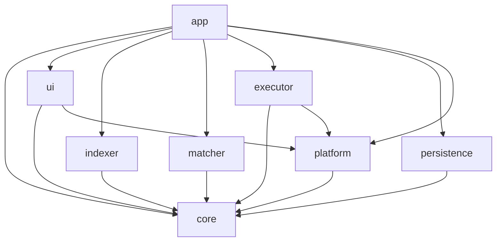
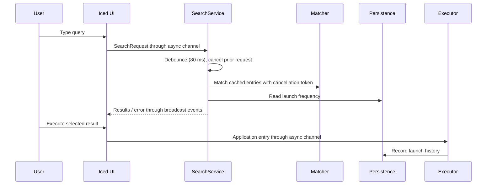

# Architecture

## Crates

`core` owns domain types and trait contracts. The `app` composition root
connects adapters to the Iced UI. `indexer` discovers applications,
`matcher` scores queries, `persistence` stores application data and settings,
`executor` launches entries, and `platform` contains OS-specific integration.
UI and async orchestration depend on abstractions where the core defines them.

## Search and launch flow

Index refresh runs asynchronously. Existing cached entries remain searchable
until the completed index atomically replaces them. Shutdown cancels active
search and re-index work, flushes index/history/config, unregisters hotkeys,
then removes tray resources and releases the single-instance guard.

## Runtime and release notes

- The Windows tray message pump owns a dedicated thread.
- Synchronous Win32 and config-file operations are kept off the Iced update
  loop; app and shortcut launches use the Tokio blocking pool.
- Release profile uses optimization level 3, fat LTO, one codegen unit,
  stripped symbols, and abort-on-panic.
- Release binary size and benchmark process memory are reported in
  [BENCHMARKS.md](BENCHMARKS.md). GUI idle-memory and clean-VM installer
  measurements require a representative Windows 10/11 test machine.
